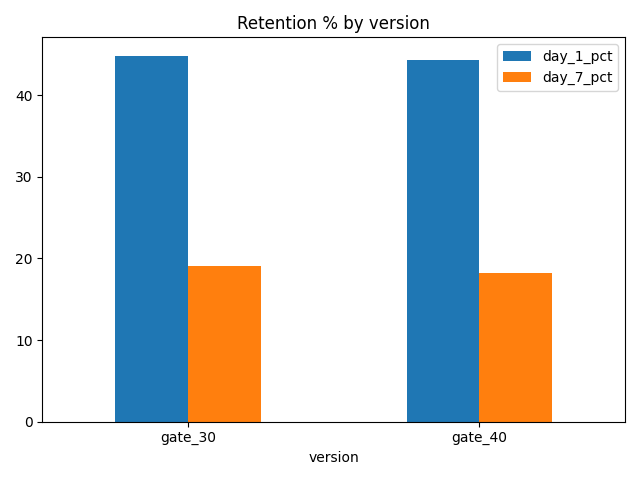

# Cookie Cats A/B Test

A/B test analysis of the mobile game Cookie Cats using Python and SQL.

## Question
In the game, players reach a gate at level 30 where they have to wait or pay to continue. The company tested moving the gate to level 40. Does this make more players come back to the game?

## Data
90,189 players, randomly split into two groups: gate_30 (44,700 players) and gate_40 (45,489 players). For each player we know the number of rounds played and whether they came back after 1 day and after 7 days.

## What I did
1. Checked the data for missing values and duplicates.
2. Used SQL to calculate day 1 and day 7 retention for each group.
3. Used a z-test to check if the difference is real or by chance.
4. Made charts with matplotlib.

## Results

| | gate_30 | gate_40 | p-value |
|---|---|---|---|
| Day 1 retention | 44.82% | 44.23% | 0.074 |
| Day 7 retention | 19.02% | 18.20% | 0.0016 |

- Day 7 retention is lower with the gate at level 40, and the p-value is less than 0.05, so the drop is real.
- The day 1 difference is not significant.

## Recommendation
Keep the gate at level 30.

## Limitations
There is no revenue data, and the data covers only 14 days.

## Files
- `cookie_cats_ab_test.ipynb`: the full analysis
- `cookie_cats.csv`: the data
